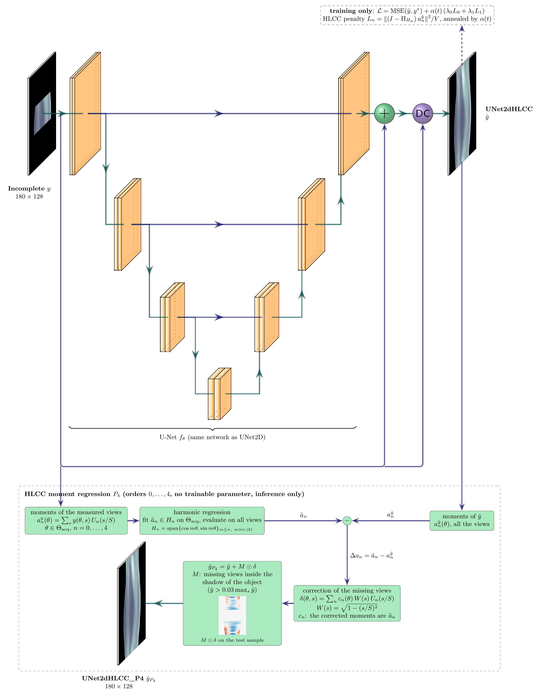

# Limited-angle sinogram completion

Code of my Master's thesis. A parallel-beam sinogram has 180 views over [-90, 90) degrees, but only the window
[-25, 25] is measured. The models complete the 129 missing views, and a training-free post-processing based on the
Helgason-Ludwig consistency conditions (HLCC) corrects the low-order moments of their output.

<p align="center">
  
</p>
<p align="center"><em>UNet2dHLCC_P4: the U-Net trained with the HLCC penalty, followed by the HLCC moment regression of
orders 0 to 4 on the missing views.</em></p>

## Models

| Name | Model | Loss |
|---|---|---|
| `UNet2D` | residual U-Net on the sinogram | MSE |
| `UNet2dHLCC` | the same network | MSE + annealed HLCC penalty, orders 0-1 |
| `GCN` | view-graph GCN: one node per view, kNN graph with k = 12 | MSE |
| `SNN` | SinoSheavesNN: the same graph and parameters, with fixed restriction maps that shift each stalk along the detector by t_f (theta_i - theta_j) | MSE |
| `<model>_P4` | any model followed by the HLCC moment regression (Huang et al., 2017) | no training |

The U-Net follows Ronneberger et al. (2015) and the GCN Kipf & Welling (2017). The view graph, one node per
projection angle, is inspired by GLM (Valat & Öktem, 2025), and the SNN builds on sheaf neural networks (Hansen &
Ghrist, 2019; Hansen & Gebhart, 2020; Bodnar et al., 2022). Every learned model applies hard data consistency: the
measured views come out unchanged. The graph models are compared at 6, 12 and 18 layers; their angular reach is
`num_layers * k/2` views, i.e. 36, 72 and 108 degrees, while the farthest missing view is 65 degrees away from the
acquired window.

## Results

Mean over the 200 test samples. The wedge is the set of missing views; the image PSNR is computed after filtered
back-projection of the completed sinogram.

| Model | Wedge MSE | Wedge PSNR (dB) | Image PSNR (dB) | Wedge MSE with P4 |
|---|---|---|---|---|
| Zero filling | 2.71e-2 | 17.67 | 16.03 | |
| Linear interpolation | 8.24e-3 | 22.66 | 15.95 | |
| `UNet2D` | 8.15e-4 | 33.43 | 23.35 | 7.26e-4 (-11.0 %) |
| `UNet2dHLCC` | 8.17e-4 | 33.73 | 23.43 | 7.36e-4 (-9.9 %) |
| `GCN_L6` | 9.13e-3 | 21.57 | 18.49 | 2.64e-3 (-71.0 %) |
| `SNN_L6` | 9.27e-3 | 21.50 | 18.57 | 2.66e-3 (-71.3 %) |
| `GCN_L12` | 2.70e-3 | 27.42 | 20.13 | 1.84e-3 (-31.7 %) |
| `SNN_L12` | 2.61e-3 | 27.49 | 20.11 | 1.89e-3 (-27.5 %) |
| `GCN_L18` | 2.40e-3 | 28.20 | 20.25 | 1.84e-3 (-23.4 %) |
| `SNN_L18` | 1.93e-3 | 29.13 | 20.96 | 1.47e-3 (-23.7 %) |

- The two U-Nets are the most accurate and almost identical: the HLCC penalty barely changes the test error.
- With 6 layers the graph models cannot reach the whole wedge and stay close to linear interpolation in wedge MSE;
  deeper graph models improve but remain behind the U-Net.
- P4 lowers the wedge MSE of every model, on 185 to 200 of the 200 test samples.

All tables (standard deviations, seed replicas, angular reach, data regimes, training cost) are in `results/tables/`
and the figures in `results/figures/`.

## Repository

```
src/
  config.py            GeometryConfig: angles, detector, image grid
  geometry.py          parallel-beam geometry, ASTRA forward projection and FBP
  dataset.py           random phantoms and (incomplete, full) sinogram pairs, seeded splits
  hlcc.py              Helgason-Ludwig conditions and the moment regression P_K
  losses.py            HLCC penalty and the annealed MSE + HLCC loss
  metrics.py           sinogram metrics, on the whole sinogram and on the missing wedge
  checkpoint.py        self-describing checkpoints
  paths.py             output folders
  plotting.py          shared plotting style and training figures
  train.py             training, on one GPU or with torchrun
  evaluate.py          evaluation on the test split
  optuna_search.py     hyperparameter search
  models/
    factory.py         build, name and reload every model
    baselines.py       zero filling, linear interpolation
    data_consistency.py
    unet.py
    view_graph/        GCN and SNN: graph operators, layers, network
scripts/               experiment launchers, reports and figures
tests/                 unit and end-to-end tests
results/               thesis tables (CSV + LaTeX), figures (PDF) and the analysis notebook
```

Checkpoints, logs, Optuna studies and intermediate figures go to `outputs/` and `db/`, which are not versioned.

## Setup

```bash
conda env create -p ./.venv -f environment.yml
```

The environment provides Python 3.10, PyTorch 2.7 (CUDA 11.8) and the ASTRA toolbox 2.5 (van Aarle et al., 2016),
whose projector needs a CUDA GPU. Every command runs from the repository root. The architecture figures also need
[PlotNeuralNet](https://github.com/HarisIqbal88/PlotNeuralNet), cloned into `tools/PlotNeuralNet`, and a LaTeX
compiler.

## Usage

```bash
# Tests: geometry, HLCC on the ground truth, data consistency, seeded splits, models, end-to-end training
.venv/bin/python -m pytest

# Training as in the thesis (8 GPUs x batch 4); checkpoints in outputs/2d/checkpoints/<run_name>/
.venv/bin/torchrun --nproc_per_node=8 -m src.train --model UNet2D --use-wandb
.venv/bin/torchrun --nproc_per_node=8 -m src.train --model UNet2dHLCC --use-wandb
# The same effective batch on one GPU
.venv/bin/python -m src.train --model UNet2D --grad_accum_steps 8

# Evaluation on the test split, then results/model_analysis.ipynb for the tables and figures
.venv/bin/python -m src.evaluate
```

Model names accept suffixes (`src/models/factory.py`): `GCN_L12` selects the depth, `UNet2D_N200` the run saved under
that name (`--run_name`), and `UNet2D_P4` adds the moment regression of orders 0 to 4.

Experiments of the thesis:

```bash
# Optuna on lr / weight_decay: create the study, one worker per GPU on it, then train the best trial
args="--model GCN --num_layers 12 --optimizer-only"
.venv/bin/python -m src.optuna_search $args --create-only
for gpu in 0 1 2 3 4 5 6 7; do
    CUDA_VISIBLE_DEVICES=$gpu .venv/bin/python -m src.optuna_search $args --n-trials 4 &
done; wait
.venv/bin/python -m scripts.launch_best_training GCN_L12_parallel_optimizer_only --run
.venv/bin/python -m scripts.launch_best_training GCN_L12_parallel_optimizer_only --model SNN --run

# U-Net vs U-Net + HLCC with 200 training phantoms, seen 10 times per epoch (same steps as the 2000-phantom runs
# above), then the paired comparison; seed replicas add --seed 1 --run_name <run>_S1
.venv/bin/torchrun --nproc_per_node=8 -m src.train --model UNet2D --run_name UNet2D_N200 --n_samples 200 --train_repeats 10
.venv/bin/torchrun --nproc_per_node=8 -m src.train --model UNet2dHLCC --run_name UNet2dHLCC_N200 --n_samples 200 --train_repeats 10
.venv/bin/python -m src.evaluate --models $(.venv/bin/python -m scripts.data_study_report --print_models)
.venv/bin/python -m scripts.data_study_report

# Checks and figures
.venv/bin/python -m scripts.check_data_consistency   # acquired views of the outputs minus the measured ones: 0
.venv/bin/python -m scripts.hlcc_order_study         # why the moment regression stops at order 4
.venv/bin/python -m scripts.measure_peak_vram        # peak GPU memory of the runs that did not record it
.venv/bin/python -m scripts.plot_architectures       # architecture figures (PlotNeuralNet + LaTeX)
```

## Reproducibility

- **Data.** Phantoms are generated on the fly from per-sample seeds: every machine gets the same training,
  validation and test sets, independently of the number of GPUs.
- **Hardware.** Every model was trained on 8 Tesla K80 GPUs (12 GB) with a batch of 4 per GPU, i.e. an effective batch
  of 32, for 200 epochs: from 51 min for a U-Net to 5 h 26 min for the 18-layer SNN, with at most 6.2 GiB per GPU.
- **Fewer GPUs.** Keep the effective batch of 32 with `--grad_accum_steps 8/N` on N GPUs (`8` on one GPU); the memory
  stays the one of a batch of 4. No normalisation depends on the batch, so this optimises the same objective with the
  same number of steps and the same learning-rate schedule (`tests/test_training_pipeline.py`). The batch order
  differs, so a retrained model matches the thesis up to run-to-run noise, measured by the seed replicas in
  `results/tables/seeds_*`.
- **Hyperparameters.** The U-Nets use the defaults of `src/train.py`. The graph models add the learning rate and
  weight decay found by Optuna for the GCN of each depth, shared by the SNN (rounded here, exact values in each
  checkpoint):

  | Depth | `--lr` | `--weight_decay` |
  |---|---|---|
  | 6 layers | 1.15e-3 | 5.82e-4 |
  | 12 layers | 4.26e-4 | 8.70e-5 |
  | 18 layers | 3.20e-4 | 1.02e-4 |

  ```bash
  .venv/bin/torchrun --nproc_per_node=8 -m src.train --model SNN --num_layers 18 --lr 3.20e-4 --weight_decay 1.02e-4
  ```

## Protocol

- **Geometry** (`src/config.py`): rotating parallel beam, 1 degree steps, 128 detector pixels of 1.6 mm. The ground
  truth satisfies the HLCC (Helgason, 1965; Ludwig, 1966) up to discretisation error (`tests/test_physics_loss.py`).
- **Data** (`src/dataset.py`): the `train`, `val` and `test` splits are fixed, disjoint and independent of the global
  RNG. Inputs carry Poisson noise, targets are clean.
- **HLCC** (`src/hlcc.py`, `src/losses.py`): penalty of orders 0 to `--hlcc_max_order` in the loss of `UNet2dHLCC`
  (weights 1e-3), residuals `hlcc_residual_<n>` in the evaluation, and the moment regression `_P4` as a
  post-processing.
- **Metrics** (`src/metrics.py`): fixed `data_range = 1`, on the whole sinogram and on the missing wedge. Checkpoints
  are selected on the validation wedge MSE.
- **Checkpoints** (`src/checkpoint.py`) store the architecture, the geometry, the metrics and the git commit;
  `get_model` reloads them strictly and raises on any mismatch.

## License

MIT, see [LICENSE](LICENSE).

## References

- C. Bodnar et al., "Neural sheaf diffusion: a topological perspective on heterophily and oversmoothing in GNNs",
  *NeurIPS*, 2022.
- J. Hansen, T. Gebhart, "Sheaf neural networks", *NeurIPS Workshop on Topological Data Analysis and Beyond*, 2020.
- J. Hansen, R. Ghrist, "Toward a spectral theory of cellular sheaves", *Journal of Applied and Computational
  Topology*, 2019.
- S. Helgason, "The Radon transform on Euclidean spaces, compact two-point homogeneous spaces and Grassmann
  manifolds", *Acta Mathematica*, 1965.
- Y. Huang et al., "Restoration of missing data in limited angle tomography based on Helgason-Ludwig consistency
  conditions", *Biomedical Physics & Engineering Express*, 2017.
- T. N. Kipf, M. Welling, "Semi-supervised classification with graph convolutional networks", *ICLR*, 2017.
- D. Ludwig, "The Radon transform on Euclidean space", *Communications on Pure and Applied Mathematics*, 1966.
- O. Ronneberger, P. Fischer, T. Brox, "U-Net: convolutional networks for biomedical image segmentation", *MICCAI*,
  2015.
- E. Valat, O. Öktem, "Improving the generalisation of learned reconstruction frameworks",
  [arXiv:2511.12730](https://arxiv.org/abs/2511.12730), 2025.
- W. van Aarle et al., "Fast and flexible X-ray tomography using the ASTRA toolbox", *Optics Express*, 2016.
